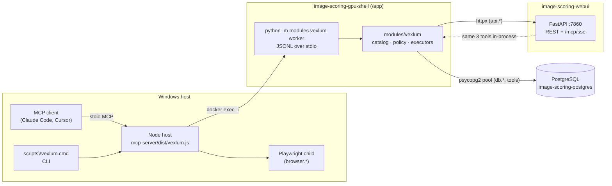
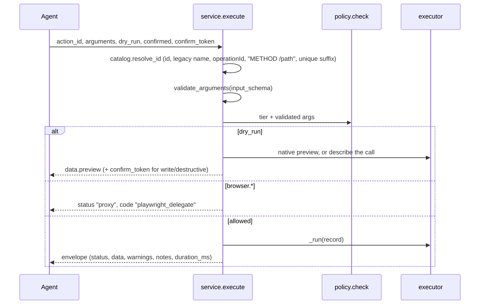

# vexlum — architecture and extension guide

**Contract and usage:** [../technical/VEXLUM_MCP.md](../technical/VEXLUM_MCP.md) — tools, tiers, CLI, setup. This page covers how it is built and how to change it. Introduced by [#758](https://github.com/synthet/image-scoring-pipeline/issues/758) / [PR #762](https://github.com/synthet/image-scoring-pipeline/pull/762).

## Design in one paragraph

Every capability of the backend — Python tools, REST operations, direct SQL, browser automation — is a **record in one catalog**. Agents see three verbs: `search` (BM25 over the catalog, never executes), `resolve` (full contract for one id) and `execute` (validate → policy → executor). The Python core owns the catalog, validation and policy; the Node host only adds what Python cannot do in the container (the Playwright child) and the MCP/CLI front door. Old entry points are thin shims onto the same core, so there is one implementation to test.

## Process topology

| Process | Entry | Notes |
|---------|-------|-------|
| Node host | `mcp-server/src/vexlum.ts` → `dist/vexlum.js` | No subcommand or `mcp` → stdio MCP server (`createVexlumServer.ts`); `search`/`resolve`/`exec`/`list`/`status` → CLI (`cli.ts`). Starts the worker immediately (`warmPythonWorker`) so the catalog warms while the client initializes. |
| Python worker | `python -m modules.vexlum worker` (`modules/vexlum/worker.py`) | Long-lived; one request per stdin line. A background thread builds the catalog and imports `modules.mcp_server` off the request path (`VEXLUM_WARM=0` disables). |
| Python-only stdio | `python -m modules.vexlum mcp` (`mcp_stdio.py`) | FastMCP server with the same three tools; no `browser.*` execution. Used by the deprecated Python entry points. |
| WebUI SSE | `modules/mcp_server.py` (`_compact_mcp_sse`) | Registers the same tools via `register_vexlum_tools` inside the WebUI process; tools are async and offload to threads so an `api.*` call back into the same server cannot block the event loop. |

### Worker launch modes (`mcp-server/src/utils/pythonBridge.ts`)

`resolveWorkerLaunch` picks one, reading `VEXLUM_<NAME>` and falling back to the deprecated `IS_BE_MCP_<NAME>`:

| Mode | When | Command |
|------|------|---------|
| `gpu-shell` | Windows default | `docker exec -i -w /app -e PYTHONPATH=/app -e ENABLE_MCP_SERVER=1 <passthrough env> image-scoring-gpu-shell python -m modules.vexlum worker` (`VEXLUM_GPU_SHELL` renames the container) |
| `wsl` | `VEXLUM_USE_WSL=1` | `wsl bash -lc "cd <repo> && source $VEXLUM_VENV_ACTIVATE && python -m modules.vexlum worker"` (default venv `~/.venvs/tf`) |
| `bash` | non-Windows | Same as `wsl` without the `wsl` prefix |
| `custom` | `VEXLUM_WORKER_SHELL` set | `bash -lc "$VEXLUM_WORKER_SHELL"` |

Passthrough env (host config wins over the container): `VEXLUM_ALLOW_ELEVATED`, `VEXLUM_API_URL`, `VEXLUM_MAX_RESPONSE_BYTES`, `VEXLUM_TOKEN_SECRET`, `MCP_PLAYWRIGHT_ENABLED`.

### Worker protocol (JSONL)

Request: `{"id": "<opaque>", "tool": "search|resolve|execute|dispatch|list|sse_status", "args": {...}}` — one line. Response: the tool's envelope plus `"_request_id": "<id>"`, one line. `__shutdown__` ends the loop. Every exception becomes `{"status": "error", "code": "handler_error"}`; the worker never dies on a bad request. `worker.json_default` serializes `datetime`, `Decimal`, `UUID`, `bytes` and similar driver types (a past crash came from a bare `json.dumps`). `service.invoke` is the single dispatch point both the worker and tests use.

## Catalog (`modules/vexlum/catalog.py`)

### Record shape

Every provider returns dicts with the same keys:

| Key | Meaning |
|-----|---------|
| `action_id` | Unique id: `category.name`, `api.<tag>.<operationId>`, `db.*`, `browser.*`, `system.*` |
| `source` | `tool` · `api` · `db` · `browser` · `system` |
| `category` | Grouping for `search(category=…)` and `system.categories` |
| `title`, `description`, `tags`, `aliases`, `intent_examples` | Search text (BM25 fields with weights) |
| `input_schema` | JSON Schema validated by `modules/mcp/actions/schema.validate_arguments` |
| `tier` | `read` · `write` · `destructive` |
| `native_dry_run` | `True` when the executor itself supports `dry_run` (e.g. `db.execute`, `prune_missing_files`) |
| `executor` | `{"kind": "registry"\|"python"\|"rest"\|"sql"\|"browser"\|"system", ...}` — how `service._run` executes it |
| `legacy_tool_name` | Old `modules/mcp_server.py` tool name; `resolve`/`execute` accept it |
| `canonical_docs`, `notes` | Returned by `resolve` and in every envelope |

### Build and cache

`_build_actions` loads the providers in `SOURCES` order; a duplicate `action_id` from a later provider is dropped with a warning. Then `_build` adds three lookups — `by_id`, `legacy` (old tool name → id) and `rest_keys` (`operationId` and `"METHOD /path"` → id) — and a `Bm25Index` (`modules/mcp/bm25.py`).

Building the `tool` provider imports `modules.mcp_server` to read signatures, which takes ~20 s on the Docker Desktop bind mount. The action list is therefore snapshotted to `~/.vexlum/cache/catalog-<fingerprint>.json`. The fingerprint hashes the **content** of the data sources (`mcp/action_registry.json`, `mcp/actions/overlay.yaml`, `mcp/tool_catalog.json`, `mcp/actions/playwright_registry.json`, `docs/reference/api/openapi.yaml`, `mcp/vexlum/rest_overrides.yaml`) and of the provider code, plus `MCP_PLAYWRIGHT_ENABLED` and `SNAPSHOT_VERSION`. Editing any of them invalidates the snapshot; bump `SNAPSHOT_VERSION` when the record shape changes. A build with provider errors is not cached. In-process, `get_catalog` rebuilds when the watched files' mtimes change.

### Providers (`modules/vexlum/providers/`)

| Provider | Source of records | Tier rules |
|----------|-------------------|-----------|
| `tools.py` | `mcp/action_registry.json` actions with `dispatch_enabled` (executor `registry`; Playwright-domain entries are left to `browser.py`), then every tool in `mcp/tool_catalog.json` not already covered (executor `python`, schema read from the `modules.mcp_server` function signature via `schema_from_callable`; permissive when that import fails) | Registry `side_effect_level` → tier; catalog tools use `WRITE_TOOLS` / `DESTRUCTIVE_TOOLS`, default `read` (the catalog's own `risk` field is unreliable) |
| `rest.py` | One record per operation in `openapi.yaml`; id `api.<first tag>.<operationId>`; path and query params become top-level properties, the JSON body becomes `body` | GET → read, POST/PUT/PATCH → write, DELETE → destructive; per-operation overrides in `mcp/vexlum/rest_overrides.yaml` |
| `db.py` | Fixed: `db.schema`, `db.query`, `db.execute` | read, read, destructive |
| `browser.py` | `mcp/actions/playwright_registry.json` (regenerated by `npm run build` → `scripts/generate_playwright_registry.mjs`); empty when `MCP_PLAYWRIGHT_ENABLED=0` | `tier_for_browser`: a short read list (navigate, snapshot, …) and destructive list (`browser.run_code_unsafe`); everything else is `write` |
| `system.py` | Fixed: `system.status`, `system.categories` | read |

## Execute path (`modules/vexlum/service.py`)

Executors (`modules/vexlum/executors/` and `service._run`):

| `executor.kind` | Runs | Details |
|-----------------|------|---------|
| `registry` | `executors/python_handler.run_registry` → `modules.mcp.actions.dispatch.dispatch_action(..., confirmed=True)` | Reuses the existing handlers. vexlum policy has already authorized the call; `confirmed=True` only satisfies the legacy dispatcher's own check, and its `ALLOWED_SIDE_EFFECT_ACTIONS` allowlist still applies inside it |
| `python` | `executors/python_handler.py` → the `modules.mcp_server` function | Legacy tools that had no registry entry |
| `rest` | `executors/rest.py` (httpx) | Base URL: `VEXLUM_API_URL` → origin of `IMGSCORE_WEBUI_MCP_SSE_URL` → `webui.lock` port → `http://127.0.0.1:7860`. `X-API-Key` from env `API_KEY` or `config.json` `api.key`, never echoed. Bodies above `VEXLUM_MAX_RESPONSE_BYTES` (default 200 000) are truncated with `truncated: true`. Connection failure → `webui_unavailable`. |
| `sql` | `executors/sql.py` | Single statement only (`mcp_sql_single_statement`). `db.query`: read-only check, then `SET TRANSACTION READ ONLY`, `max_rows` cap. `db.execute`: `PGConnectionManager(commit=not dry_run)` — a dry run executes and rolls back. Requires `database.engine = postgres`. |
| `system` | `service._status`, `service._categories` | `status` probes DB, REST base URL and the WebUI SSE |
| browser | not run in Python | Python validates and applies policy, then returns `playwright_delegate`; `mcp-server/src/utils/proxyDispatch.ts` (`executeWithPlaywrightProxy`) runs it in the Playwright child (`playwrightBridge.ts`). `MCP_PLAYWRIGHT_ENABLED=0` disables. |

## Tier policy (`modules/vexlum/policy.py`)

- `read` and any `dry_run` pass. `write` needs `confirmed`. `destructive` needs `VEXLUM_ALLOW_ELEVATED=1` in the **worker's** environment, `confirmed`, and a valid `confirm_token`.
- Token: `<expiry>.<hmac-sha256[:40]>` over `{"a": action_id, "args": canonical args, "exp": expiry}`, TTL 600 s. Key order: `VEXLUM_TOKEN_SECRET` → `~/.vexlum/confirm.key` (created 0600 on first use; `VEXLUM_TOKEN_KEY_FILE` overrides) → a per-process key if the home directory is read-only. The file key lets a CLI dry run be confirmed by a later CLI process.
- `resolve` publishes the requirements (`policy.requirements(tier)`) and a ready-made two-step example for destructive actions. Writes and destructive runs are logged (`vexlum_execute action=… tier=… request_id=… duration_ms=…`) without argument values.
- For agents this replaces the old `ALLOWED_SIDE_EFFECT_ACTIONS` allowlist in `modules/mcp/actions/policy.py`. That allowlist still runs inside `dispatch_action`, so a registry action with a side effect must be in both places; tools, REST, SQL and browser actions are governed by tiers alone.

## Extending vexlum

| Goal | Change | Then |
|------|--------|------|
| New REST endpoint | Nothing — add it to FastAPI and regenerate `openapi.yaml` | The `api` provider picks it up; run `python scripts/generate_mcp_tool_inventory.py --update-vexlum-doc` |
| REST endpoint has the wrong tier (e.g. a `POST …/preview` that only reads) or poor search hits | Entry in `mcp/vexlum/rest_overrides.yaml` keyed by `"METHOD /path"`, `operationId` or `action_id`: `tier`, `tags`, `aliases`, `intent_examples`, `notes` | Same |
| New Python tool | `@mcp.tool` in `modules/mcp_server.py` **and** an entry in `mcp/tool_catalog.json` (hand-maintained; the `--update-catalog` hint in `modules/mcp/catalog.py` names a flag that no longer exists). For richer search metadata add a registry action in `mcp/actions/overlay.yaml` and run `--update-action-registry` | If it writes, add it to `WRITE_TOOLS` / `DESTRUCTIVE_TOOLS` in `providers/tools.py` — the default is `read`. Run `--update-docs docs/technical/MCP_DEBUGGING_TOOLS.md` and `--update-vexlum-doc` |
| New browser action | `scripts/generate_playwright_registry.mjs` / the Playwright bridge | `npm run build` regenerates `playwright_registry.json` |
| New provider (e.g. a second service) | Module in `providers/` returning records of the shape above; add it to `catalog._load_provider` and `SOURCES`; add its file to `_FINGERPRINTED_CODE`; add an executor kind to `service._run` | Tests in `tests/vexlum/test_catalog.py` (ids unique, provider loads) |

Every change to the catalog's sources changes the counts block in `VEXLUM_MCP.md`; CI (`.github/workflows/mcp-tool-doc-sync.yml`) fails until `--update-vexlum-doc` is rerun.

## Tests

| Area | Tests |
|------|-------|
| Catalog: providers load, REST count = operationIds, every legacy tool resolves, unique ids | `tests/vexlum/test_catalog.py` |
| Policy matrix, token HMAC/TTL/arg binding, key file, elevated gate | `tests/vexlum/test_policy.py` |
| search / resolve / execute / dispatch alias / browser delegate | `tests/vexlum/test_service.py` |
| REST request building, API key header, truncation, unreachable WebUI | `tests/vexlum/test_rest_executor.py` (mocked httpx) |
| SQL gate, single statement, rollback on dry run; one live `db` test | `tests/vexlum/test_sql_provider.py` |
| CLI round trips | `tests/vexlum/test_cli.py` |
| MCP tool registration (FastMCP v1 only) | `tests/vexlum/test_mcp_surface.py` |
| Node host: CLI parser, worker launch modes, Playwright delegate | `mcp-server/src/*.test.ts` (`npm run test:unit`) |
| Old worker shim | `tests/test_mcp_compact_worker.py` (see [#765](https://github.com/synthet/image-scoring-pipeline/issues/765)) |

`tests/vexlum/conftest.py` points `VEXLUM_CACHE_DIR` and `VEXLUM_TOKEN_SECRET` at test values so runs never touch `~/.vexlum`.

## Deprecated surfaces and removal

Kept as shims in #762 so existing configs keep working: `mcp-server/dist/compactIndex.js` (`is-be-mcp`), the compact `/mcp/sse` profile (`is-be-live`), `python -m modules.mcp_server` (`VEXLUM_LEGACY_FULL_STDIO=1` restores the old server), `modules/mcp/router_server.py`, `modules/mcp/proxy_server.py`, `scripts/mcp/compact_worker.py`, `scripts/batch/run_mcp_*.bat`, and `MCP_SSE_PROFILE=full` / `MCP_TOOL_PROFILE`. Removal is a later change: drop the shims and their tests, the `mcp__is-be-mcp__*` allows in `.claude/settings.json`, and the deprecated aliases `dispatch` / `sse_status`.

## Related

- [../technical/VEXLUM_MCP.md](../technical/VEXLUM_MCP.md) — contract and usage
- [../technical/MCP_SEARCH_DISPATCH.md](../technical/MCP_SEARCH_DISPATCH.md) — previous contract (deprecated)
- [../technical/MCP_DEBUGGING_TOOLS.md](../technical/MCP_DEBUGGING_TOOLS.md) — per-tool reference for the `tool` source
- Gallery counterpart: Driftara Gallery MCP in [image-scoring-gallery](https://github.com/synthet/image-scoring-gallery)
