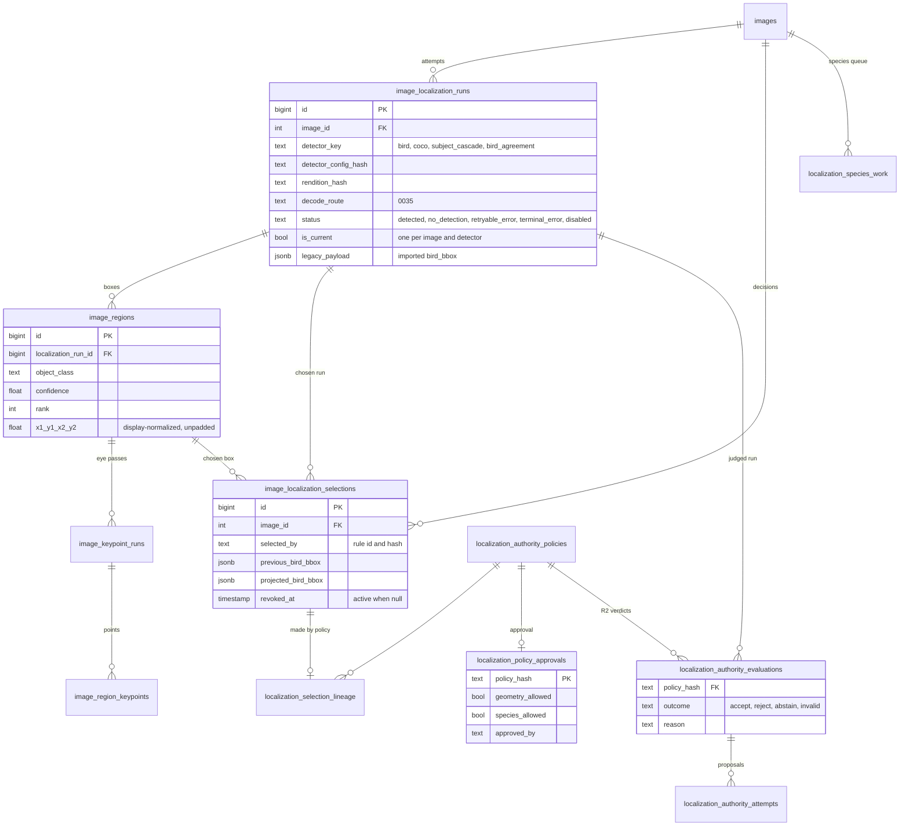
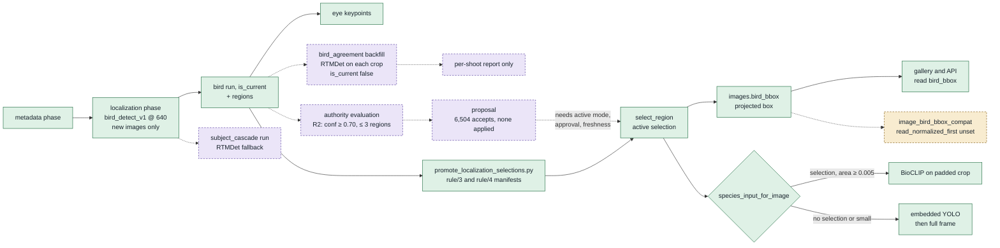
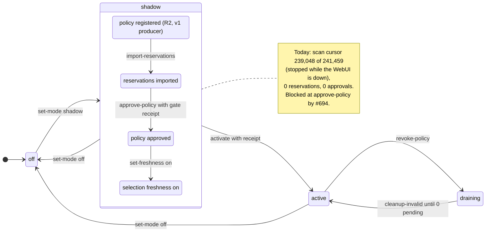
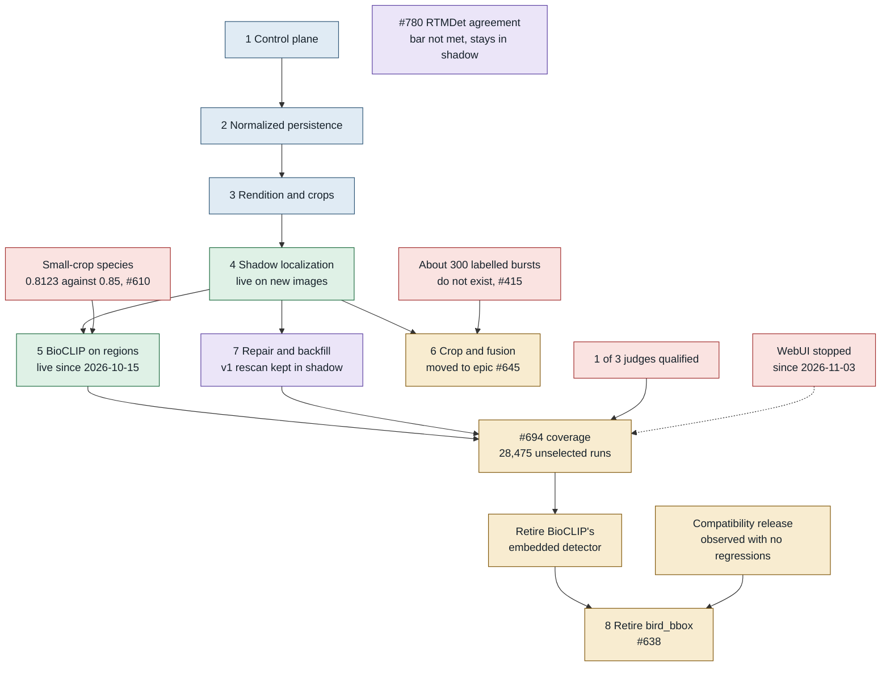

# Localization rollout diagrams

Epic #345, schema through migration 0048. Live figures are from read-only queries at 2026-11-05 03:10 UTC and will drift.

These are the views the rollout docs don't draw:

- [Data model](#data-model): how the tables relate.
- [From a detector box to what consumers read](#from-a-detector-box-to-what-consumers-read): how a box becomes the one everything else reads.
- [Authority lifecycle](#authority-lifecycle): how the runtime moves from shadow to active.
- [Stages and gates](#stages-and-the-gates-that-hold-them): which gates hold each stage.

Design and history: [localization-rollout.md](localization-rollout.md). Current plan: [localization-rollout-plan-2026-11-04.md](../../planning/localization-rollout-plan-2026-11-04.md).

## Data model

Every detector attempt is an immutable run. At most one run per image and detector is current, and the regions hang off the run. A **selection** is the separate decision that one region counts, and it is the only path that writes `images.bird_bbox` for promoted images. The authority tables record why a selection was proposed or made.

- Unique indexes enforce one current run per `(image_id, detector_key)` and one active selection per `(image_id, detector_key)`. `bird_agreement` runs are written with `is_current` false (spec 08 AC-13), so they never take the current slot.
- 802 images have more than one current detected run. Each has a `subject_cascade` run plus either a `bird` run (787) or a `coco` run (15). The index allows that because the detector keys differ, and readers that don't filter on `detector_key` see two runs.
- The view `image_bird_bbox_compat` (0043) reads the active selection's projected box first, then the imported legacy payload, then `images.bird_bbox`. Nothing reads it by default while `read_normalized_first` is unset.
- Not drawn: `localization_authority_control` (one row holding the mode and scan cursor), reservations, journal, discovery evidence, recovery attempts, species outputs.

## From a detector box to what consumers read

Selections so far came from the manifest script, plus 19 from the 2026-10-23 box review. The authority runtime is built, but it only evaluates. Downstream, BioCLIP crops the selected region when there is one, and otherwise falls back to its own embedded YOLO.

**Key:** green is live, purple dashed is shadow, amber dashed is built but off.

- 4,665 selections are active: 4,372 from rule/3, 274 small ones from rule/4 (geometry only), and 19 from the box review. That is about 12% of the 38,479 bird-tagged images counted on 2026-10-25, or 9% of the 52,135 images with a current detected bird run.
- Small selections (area < 0.005) still go to the embedded detector for species, until #610 passes.
- The embedded YOLO path is what Stage 8 retires. It stays on (`embedded_detector` default true) until selections cover the bird-tagged images.
- Species work under the authority (`localization_species_work`) runs only in active mode, so today species still comes from the `bird_species` phase.

## Authority lifecycle

The operator commands in `scripts.maintenance.localization_authority` move the single control row through three modes. Today it is in **shadow**, with one registered R2 policy, 0 reservations and 0 approvals. Approval waits on the #694 gate, which needs three qualified judges and has one.

- Shadow writes evaluations, proposals and lineage only. Fingerprints of `bird_bbox` and the selections table matched the baseline on 2026-11-02.
- The scan bound is the highest run that isn't `bird_agreement`. Those shadow rows push `max(id)` higher (248,923) without adding work the rule can judge.
- Turning the mode off stops new applications, and published outputs stay. Revoking a policy removes only the outputs it owns, through the cleanup queue. Turning freshness off needs a separately reviewed reader rollback.
- Migration 0047 refuses a downgrade until a preservation migration is reviewed. Reverting code does not roll back data.

## Stages and the gates that hold them

The eight stages from the epic, colored by state as of 2026-11-05. Red nodes are blockers, and each arrow from a blocker points at what it holds.

**Key:** blue is done, green is live, purple is running in shadow, amber is waiting or research, red is a blocker.

- Even if #694 passes, R2 accepts 6,504 runs. That leaves the 21,032 v0 runs (out of producer scope) and the 4,146 bird-tagged no-detection images uncovered, so detector retirement may need another rule or a relocalization pass (#810).
- #780 is finished. The owner review missed the bar (12.0% of false-eye regions removed, 2.6% of birds lost), so agreement stays a shadow measurement. It never gated #694 or Stage 8.
- The WebUI stopped when the laptop went to sleep on 2026-11-03. That only pauses the shadow scan, which is about 2,400 runs from the end, and does not block approval.

## Sources

- **Schema:** `migrations/versions/0034`, `0035`, `0036`, `0038`, `0043`, `0045` to `0048`.
- **Code:** `modules/localization_selection.py` (`select_region`, `revoke_selection`), `modules/bird_species.py` (`species_input_for_image`, embedded detector check), `modules/localization.py` (`write_run(publish=…)`), `scripts/maintenance/promote_localization_selections.py`.
- **Docs:** [LOCALIZATION_AUTHORITY.md](../../technical/LOCALIZATION_AUTHORITY.md), [localization-rollout.md](localization-rollout.md), [spec 08](../../specs/pipeline-streamlining/08-bird-box-agreement.md).
- **Live counts:** read-only database queries of 2026-11-05 and #694 comments of 2026-11-02.
