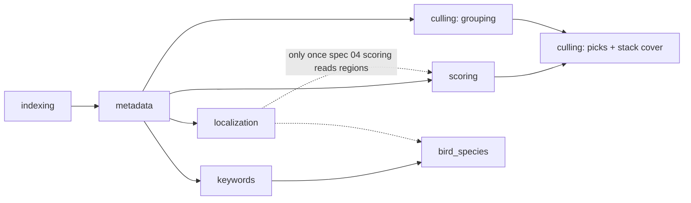

# Phase graph review against data dependencies

**Issue:** #407 · **Spec:** [02 — phase graph](../specs/pipeline-streamlining/02-phase-graph.md) ·
**Reference:** [phase-graph.md](../architecture/pipeline/phase-graph.md)

Every edge in the phase graph should be backed by data: a consumer phase that reads something the
producer writes, today. This review rebuilds the graph from the code on master `808861b3`, checks
each edge for a live consumer, prices the edges with the
[timing baseline](timing-baseline-2026-10-18.md), and applies the result to the two decisions left
open on #407.

Docker was stopped during the review, so no live counts were taken. Library-wide figures are quoted
from the [Stage 8 readiness report](localization-stage8-readiness-2026-10-23.md).

## Decisions

| Item | Decision | Why |
|---|---|---|
| #407 AC-9: auto-drive inserts `localization` ahead of `scoring` | **Superseded.** Auto-drive keeps localization out of its buckets, as #527's lane does now. | Scoring reads no localization output (spec 04 is still `proposed`), so the insertion delays scores by the detector's cost (0.33 s local, about 2.3 s routed, p50) and gives nothing back. |
| `pipeline.culling_requires_scoring` | **Stays `true`.** Turn it off only after G1 and #678 are fixed. | Two defects sit on the flag-off path, below. The gain is small: auto-drive already runs culling right after scoring in the same job. |
| Graph changes C-1 to C-4 (below) | Proposed for implementation. | Each one removes an edge with no consumer, or adds one that a live consumer needs. |

## What each phase reads and writes

| Phase | Reads | Writes | Source |
|---|---|---|---|
| `indexing` | Files on disk | `images` rows, `image_hash`, folder assignment | [indexing.md](../architecture/pipeline/phases/indexing.md) |
| `metadata` | Image file, XMP | `image_exif` (capture time, orientation, `af_metadata`), thumbnails, XMP | [metadata.md](../architecture/pipeline/phases/metadata.md) |
| `localization` | Rendition of the image (needs metadata orientation) | `image_localization_runs`, `image_regions`, `image_localization_selections` (the active `bird` selection) | `modules/localization.py`, [rollout stage 4](../architecture/pipeline/localization-rollout.md) |
| `scoring` | Full-frame scoring input from `scoring_preprocess` | `image_model_scores`, `images.score_general` and rating/label, XMP | [scoring.md](../architecture/pipeline/phases/scoring.md) |
| `culling`: grouping | `image_hash`, `image_exif.date_time_original`, thumbnails, `burst_uuid` | `stacks`, `images.stack_id`, `burst_uuid`, MobileNetV2 embedding | [culling.md](../architecture/pipeline/phases/culling.md) |
| `culling`: picks | `score_general` (plus `clip_quality_v0` when enabled) | `cull_decision`, `pick_status`, XMP | `modules/selection.py`, `selection_policy.py` |
| `culling`: stack cover | `score_general` under the configured `stack_representative_strategy = score` | `stacks.best_image_id` | `modules/clustering.py::_select_best_image` |
| `keywords` | Thumbnail; reuses a stored `clip_vit_b32_image` vector when present | Normalized keywords, CLIP/BLIP image embeddings | [keywords.md](../architecture/pipeline/phases/keywords.md) |
| `bird_species` | The `birds` keyword (its scope), the active `bird` localization selection (`bird_species.use_regions = true`) | Species keywords, `bird_bbox` | [bird-species.md](../architecture/pipeline/phases/bird-species.md), `modules/bird_species.py` |

The keypoint module (`modules/keypoints.py`) also reads localization regions, but it isn't a
phase.

## Edge audit

| Edge | Kind on master | Live consumer? | Verdict |
|---|---|---|---|
| `indexing → metadata` | hard | yes: identity and folder | keep |
| `metadata → localization, scoring, keywords` | hard | yes: thumbnails, orientation, EXIF | keep |
| `scoring → culling` | hard, or `metadata → culling` with the flag off (#676) | **picks and the stack cover only**; grouping reads no score | keep the flag default (decision above) |
| `keywords → bird_species` | hard | yes: the `birds` keyword is the species scope | keep until the scene route (spec 05) can supply scope; decision G-2 |
| `localization ⇢ scoring` | attempt-before (#671) **and** preferred-before | **no**: scoring reads no region until spec 04 | **C-1**: make inert until a subject-aware scoring flag exists |
| `localization ⇢ keywords` | preferred-before | **no**: tagging never reads regions | **C-2**: drop |
| `localization ⇢ bird_species` | preferred-before only | **yes**: region crops; without a selection the runner falls back to its own YOLO | **C-3**: promote to attempt-before |
| `scoring → keywords` | removed by #668 | none | done |

### Why `localization ⇢ bird_species` matters

`species_input_for_image` returns `legacy` when an image has no active `bird` selection. The runner
then classifies with `use_detector=True`, which runs the embedded YOLO. When the
lane (`modules/localization_lane.py`) localizes that image later, the detector runs a second
time. The Stage 8 report counts about **33.8k bird-tagged images with no selection** that still go
through the embedded detector, and lists that as a #638 gate. An attempt-before edge to
`bird_species` runs the detector once, at the point where its output is used.

## Cost of the edges

From the [timing baseline](timing-baseline-2026-10-18.md): p50 per image on the RTX 4060 8 GB card,
after warm-up.

| Stage | p50 ms | Phase |
|---|---:|---|
| `yolo640`, production route | 2,292 | localization |
| `local_yolo640`, local control | 329 | localization |
| `scoring_preprocess` | 1,636 | scoring |
| MUSIQ ×2 + LIQE + TOPIQ + ARNIQA, full frame | ≈ 180 | scoring |
| `clip_b32_keywords` + `blip_caption` | ≈ 725 | keywords |
| `bioclip_encode` | 142 | bird_species |

Running localization before scoring adds about 18% (local) to 126% (routed) to the roughly 1.8 s
each image spends in scoring preprocessing and models.
That buys nothing until scoring reads regions.

## Optimized graph

Solid lines are hard prerequisites; dashed lines are attempt-before edges (never blocking).

**Execution order per folder (single GPU, one stage at a time):** `indexing → metadata → scoring →
culling → keywords → localization (bird-tagged images without a current attempt) → bird_species`.
The lane localizes everything else in idle time.

Scores and picks, the main product, come first. Keywords no longer wait on scoring for a
keywords-only submission (#668). Localization runs where its one live consumer needs it.

`PIPELINE_PHASE_ORDER` doesn't need to change for this. It's a UI and contract ordering, and
attempt-before insertion decides where an extra localization stage goes.

## Proposed changes

| ID | Change | Files | Risk |
|---|---|---|---|
| C-1 | Gate the `localization → scoring` attempt-before entry behind a subject-aware-scoring flag (default off), so the edge is inert until spec 04 ships. The insertion code from #671 stays. | `modules/phases.py`, `tests/test_attempt_before_planning.py` | Low. It's the rollback spec 02 planned: empty the table entry. |
| C-2 | Remove `keywords` from `PHASE_PREFERRED_BEFORE[localization]`. | `modules/phases.py`, executor projection tests | Low. Advisory only, and never used for planning. |
| C-3 | Add `localization → bird_species` to `PHASE_ATTEMPT_BEFORE`, scoped to bird-tagged images without a current attempt. `bird_species` skips `PipelineOrchestrator` and is special-cased in submit paths, so the insertion needs its own handling there and in auto-drive. | `modules/phases.py`, `electron_runs_lifecycle.py`, `workflow_healing.py`, `runs_autodrive.py`, tests | Medium. It touches the bird_species dispatch special case. |
| C-4 | When the AC-12 follow-up re-runs culling for pending stacks, also recompute `stacks.best_image_id` from `score_general` (G1 below). | `modules/selection.py` or `clustering.py`, `tests/test_culling_pending_picks.py` | Low. It only matters with the flag off. |

## Defects on the flag-off path

- **G1: stack cover chosen without scores.** With `stack_representative_strategy = score`, stacks
  created before scoring get their cover from the EXIF tie-break alone. `best_image_id` is only
  recomputed from `score_general` when stacks are cleared or edited (`clear_stacks_in_folder`,
  `remove_images_from_stack`, `delete_image`). The AC-12 follow-up doesn't clear stacks, because
  clustering skips folders that are already clustered unless `force_rescan` is set, so the cover
  never updates. Fixed by C-4.
- **#678: pick cap exceeded.** `allocate_picks_uniform` hands out more than `N` picks when
  sub-stacks outnumber `N`. That applies with or without the flag, but flag-off culling runs more
  often, so fix it first.

The AC-12 follow-up itself does reach pending stacks. `get_culling_incomplete_predicate_sql` treats
`cull_decision IS NULL` as incomplete, and `SelectionService` reassigns picks across the whole
folder on every culling run.

## Not covered

- Live per-phase durations and queue latency from `jobs`: the database was down.
- Gallery effects. Nothing here changes a phase code or the canonical order.
- Multi-GPU or remote-runner parallelism. The order above assumes one GPU running one stage at a
  time.
