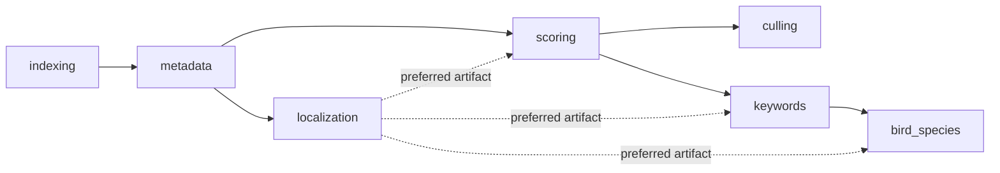

# Execution and scoring as built

Baseline `321d3a15f5ebf5f2de62cc212eb087eccf548f2e`, with working-file hashes frozen in the hub review
2026-10-23. This is observed implementation, not a rollout plan. Canonical entry points remain
[pipeline architecture](../../architecture/pipeline-architecture.md),
[MULTI_MODEL_SCORING](../../technical/MULTI_MODEL_SCORING.md) and [CANONICAL_SOURCES](../../CANONICAL_SOURCES.md).

## Phase and persistence flow

REST/Gradio/job requests → [job_dispatcher](../../../modules/job_dispatcher.py) → registered phase
executors/runners → image artifacts/results → DB facade/connector → PostgreSQL tables and events.
[phases](../../../modules/phases.py) defines seven codes and the hard DAG:

Localization is config-gated by `localization.enabled`; its preferred-before edges do not block consumers.
Submitting a disabled phase is rejected. `missing_prerequisites` checks plan **positions**, so
keywords→scoring is invalid unless scoring is already satisfied. Culling and keywords are siblings;
display order uses stored `phase_order` rather than rewriting execution history into canonical order.

Image-phase states are `not_started,queued,running,paused,cancel_requested,restarting,done,skipped,failed`.
`ALLOWED_TRANSITIONS` contains explicit idempotent edges, cancellation/restart edges and maintenance resets;
unexpected transitions warn or fail under `database.strict_phase_transitions`. Unknown status values are
currently tolerated by the helper. `job_phases.state` is a different vocabulary (including completed and
interrupted). Folder summaries aggregate image states; no persisted folder summary state machine replaces them.
`PhaseRegistry` binds code to executor version and execution functions; DB registration alone is not executability.

Scoring [pipeline](../../../modules/pipeline.py): PrepWorker produces inputs → ScoringWorker invokes
models → ResultWorker records status, score rows/provenance and derived summary/metadata. Persistence and
metadata side effects stay on the host. This review never submitted library jobs or wrote production metadata.

## Registered, active and shadow are different

[registry](../../../modules/engines/registry.py) gates runtime membership from `scoring.models`:

| enabled | shadow | Inference | Fusion |
|---|---|---|---|
| true | false | yes | yes, if successful and weighted |
| false | true | yes | no |
| true | true | yes | no; shadow wins |
| false | false | no | no |
| absent registered entry | absent | yes by default | eligible |

Profiles apply after model config; `high_throughput` disables ARNIQA entirely, including shadow.
Unknown profile warns and retains configured models. `factory.ensure_production_registry` registers SPAQ,
AVA and LIQE; module imports register TOPIQ, ARNIQA, Cursor and Claude. QPT V2 is not registered.
Retired MUSIQ KONIQ/PAQ2PIQ/VILA names are skipped by `make_musiq_wrappers`, even when requested.
Student proxies register only when config contains a `vexlum_student_*` key, preventing absent-config
activation on older installations. A weights file or embedding-space row alone does not activate inference.
`load_production_models` fails setup for failed production loads, but logs failed shadow loads and continues.

[MultiModelHost](../../../modules/engines/host.py) normalizes each native scalar to[0,1], records all active
results, and excludes shadows from the fusion dictionary. ResultWorker likewise excludes shadow scores
from primary score projections. Failed/not-loaded models remain explicit results. The input set can differ
when a model fails; composites renormalize weights over models actually present. Model identity/preprocessing
and native ranges are enumerated in [model-catalog](model-catalog.md).

## Prepared inputs and local/remote parity

[scoring_inputs](../../../modules/scoring_inputs.py) validates resolution as a positive integer (decimal
strings accepted), clamps to224..2048, rejects bool/float values. PrepWorker reuses prepared variants by
requested resolution; descriptors include preprocessing policy, source identity, upright source size,
prepared size, quality, SHA-256, bicubic-inside-no-upscale, black-square padding and decode route.
`validate_input` checks actual digest, dimensions, EXIF orientation and image integrity before inference.
This is independent model-input routing, not evidence that region IQA is active.

[remote_gpu/contract](../../../modules/remote_gpu/contract.py) API_VERSION2 / SCORING_INPUTS_VERSION1
defines model-method endpoints. The host owns preprocessing, idempotency, persistence and XMP. Config-section
fingerprints reject host/runner disagreement; PNG/NumPy transport preserves decoded arrays, and prepared
JPEG variants carry their own digest. `gpu_runner.enabled` and per-phase local/remote modes gate routing;
invalid modes raise. Runner/thread-local flags prevent recursive HTTP routing.

`RemoteGpuUnavailable` means no result was produced and permits configured fallback; `RemoteGpuAmbiguous`
means inference may still be running and must not be replayed elsewhere. Timeouts/retry-after/backoff live in
[client](../../../modules/remote_gpu/client.py) and [resilience](../../../modules/remote_gpu/resilience.py).
Mock transport parity is not proof of parity on real TF/PyTorch weights or remote hardware.

## Normalization formulas and configuration precedence

[score_normalization](../../../modules/score_normalization.py) uses normalized native model scores,
then empirical anchors `(p02,p98)`: LIQE(.311,.998), AVA(.301,.524), SPAQ(.257,.760),
TOPIQ(.390,.709), ARNIQA(.467,.746). Config anchors override these. For p98>p02:

`s≤p02: 0.15*max(s,0)/p02` (0 when p02≤0); otherwise `clip((s−p02)/(p98−p02),0,1)`.
When p98≤p02 the original score is returned. This formula has a downward discontinuity at p02;
the intended “soft floor” does **not** make it monotonic. A versioned redesign comparison is required
before changing stored-score semantics. Non-finite model payloads are also not uniformly rejected at this
boundary; that remains a documented contract gap, not a verified natural-data incident.

Fusion precedence: nonempty `scoring.fusion` → nonempty legacy `composite_weights` → defaults:

| Composite | Default weights |
|---|---|
| general | LIQE.35, SPAQ.30, TOPIQ.13, ARNIQA.10, AVA.12 |
| technical | TOPIQ.30, ARNIQA.25, SPAQ.25, LIQE.20 |
| aesthetic | AVA.40, SPAQ.50, LIQE.10 |

For present weighted models, sum(weight×rescaled)/sum(weight), clipped[0,1] and rounded4 decimals;
empty active set yields0. Rating thresholds:5≥.90,4≥.72,3≥.50,2≥.30, else1.
Label precedence: tech<.30 Red; aes>.65 and tech<.50 Purple; aes>.65 and tech>.65 Blue;
tech>.55 Green; else Yellow. These labels are technical workflow outputs, not editorial carousel fit.

## Acceptance evidence

Graph/registry: [test_phase_prerequisites_registry_sync](../../../tests/test_phase_prerequisites_registry_sync.py),
[test_engines_registry](../../../tests/test_engines_registry.py),
[test_pipeline_registry_host_skip](../../../tests/test_pipeline_registry_host_skip.py).
Fusion: [test_score_normalization](../../../tests/test_score_normalization.py) and
[test_score_normalization_fusion_config](../../../tests/test_score_normalization_fusion_config.py).
Remote: [test_remote_gpu_runner](../../../tests/test_remote_gpu_runner.py),
[test_remote_gpu_hardening](../../../tests/test_remote_gpu_hardening.py),
[test_remote_gpu_fallback](../../../tests/test_remote_gpu_fallback.py).
Real-weight, GPU and field comparisons remain separate acceptance gates. Existing historical research is
not relabeled as this campaign's held-out replay.
